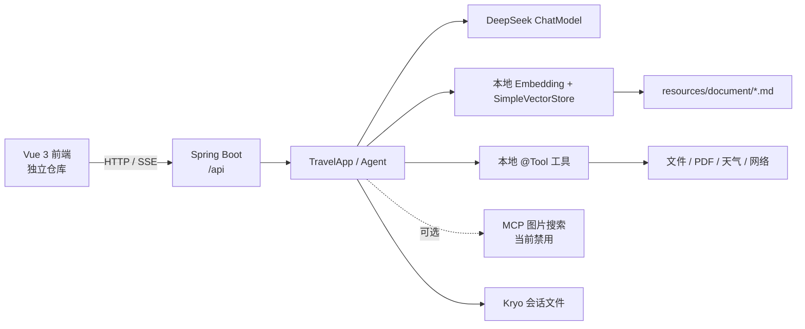

# ARCHITECTURE.md — AI 旅行规划助手

> 本文描述当前实现的边界和数据流。技术选型细节以
> [docs/project/CONVENTIONS.md](docs/project/CONVENTIONS.md) 为准。
> 最后更新：2026-11-12

## 1. 系统目标

系统把自然语言旅行需求转换为四类结果：

1. 多轮旅行问答。
2. 基于本地攻略的 RAG 回答。
3. 结构化旅行报告。
4. 可调用工具的 Agent 任务流。

这是单人学习项目，不是多租户生产系统。当前明确不引入数据库，也不承诺完整鉴权、
横向扩展或多实例会话一致性。

## 2. 运行边界



### 外部依赖

| 依赖 | 作用 | 失效行为 |
|---|---|---|
| DeepSeek | 对话、报告、Agent 推理 | 请求失败；需要错误兜底 |
| 本地 ONNX 模型 | 中文文本向量化 | RAG 初始化失败 |
| 搜索 API | 联网搜索工具 | 能力门控，不注册给 Agent |
| wttr.in | 天气查询 | 工具返回错误文本 |
| MCP image-search | 可选图片搜索 | 默认禁用，避免启动阻塞 |

## 3. 分层

| 层 | 主要代码 | 职责 | 不应承担 |
|---|---|---|---|
| API | `controller/` | 参数校验、HTTP/SSE 协议、响应映射 | 业务编排、直接拼接 Prompt |
| Application | `app/TravelApp` | ChatClient、报告、流式问答组装 | 通用模型网络重试 |
| Agent orchestration | `agent/` | 状态机、步数、循环检测、工具调用 | 具体外部 API 细节 |
| Knowledge / RAG | `rag/`, `service/`, `config/` | 文档加载、检索、上下文增强 | 用户会话管理 |
| Tools | `tools/` | 受控能力执行和结果格式化 | 绕过权限边界 |
| Memory / Config | `chatmemory/`, `config/` | 会话持久化、Bean 与模型配置 | 业务规则 |
| Cross-cutting | `common/`, `exception/`, `advisor/` | 响应、异常、日志 Advisor | 隐藏失败 |

## 4. 关键请求流

### 4.1 多轮问答

```text
AiController.chat
  -> TravelApp.doChatWithId
  -> ChatClient + MessageChatMemoryAdvisor
  -> FileBasedChatMemory
  -> BaseResponse<ChatResponse>
```

会话键是客户端提供的 `conversationId`。当前没有用户归属校验，不能把该 ID 当作授权凭证。

### 4.2 结构化报告

```text
AiController.report
  -> TravelApp.doChatWithTravelReportAndId
  -> structured output prompt/model
  -> TravelReportResponse(days / budget / assumptions / tips)
```

字段契约以 [docs/guides/API_CONTRACT.md](docs/guides/API_CONTRACT.md) 为准。

### 4.3 RAG

```text
TravelRagController
  -> TravelRagChatService
  -> similaritySearch(topK=4, threshold=0.35)
  -> 未命中: NO_MATCH_REPLY，不调用模型
  -> 命中: QuestionAnswerAdvisor + DeepSeek
```

检索在本地完成，命中的文本片段会发送给 DeepSeek。完整攻略文件与向量库不离开本机，
但这不等于“全链路离线”。

### 4.4 Agent SSE

```text
AgentController
  -> 新建 YuTravelAgent（每次请求隔离消息列表）
  -> 可用工具门控
  -> BaseAgent.runStream
  -> SseEmitter: step / loop / error / done
```

生命周期要求：

- 后台循环不能长期占用 Tomcat 请求线程。
- 必须发送显式 `done`，避免 EventSource 自动重连导致任务重复。
- 必须注册 `onTimeout`、`onCompletion`、`onError`。
- 客户端断开后，前端必须关闭 EventSource；后端任务必须有终止条件。

## 5. 状态与数据

| 数据 | 生命周期 | 当前存储 | 风险 |
|---|---|---|---|
| 会话消息 | 跨请求 | `tmp/chat-memory/*.kryo` | 会话 ID 路径校验、并发写入 |
| 向量索引 | 应用进程 | `SimpleVectorStore` 内存 | 重启重建，不能多实例共享 |
| 工具文件 | 运行时 | `tmp/file`、`tmp/pdf`、`tmp/download` | 路径穿越、资源大小 |
| Agent 状态 | 单次请求 | `AgentState` | 超时、取消、循环终止 |
| 配置 | 启动期 | 环境变量 + YAML | 密钥泄露、生产 DEBUG |

[docs/generated/db-schema.md](docs/generated/db-schema.md) 是当前“无数据库”事实和未来实体
设计的生成快照，不代表运行 schema。

## 6. 信任边界

1. 用户输入不可信：限制长度、编码、路径和 URL。
2. 模型输出不可信：工具参数必须由代码重新校验。
3. 工具结果不可信：网页、文件和外部 API 可能包含提示注入。
4. MCP 返回不可信：远程工具仍受本地权限边界约束。
5. `conversationId` 不可信：接入多用户前必须校验归属。

安全决策见 [docs/SECURITY.md](docs/SECURITY.md) 和
[docs/knowledge/security/agent-tool-security.md](docs/knowledge/security/agent-tool-security.md)。

## 7. 变更导航

| 要改什么 | 先读 | 必须同步 |
|---|---|---|
| Prompt / 模型输入 | `docs/guides/PROMPT_GUIDELINES.md` | Prompt 测试、`TEST_CASES.md` |
| Agent 循环 | `docs/guides/AGENT_DESIGN.md` | `ARCHITECTURE.md`、Agent 测试 |
| REST / SSE | `docs/guides/API_CONTRACT.md` | 前端契约、Controller 测试 |
| RAG | `docs/adr/001-local-embedding-deepseek.md` | 检索测试、技术债 |
| 工具 / 权限 | `docs/SECURITY.md` | 安全测试、ADR-002 |
| 前端交互 | `docs/FRONTEND.md` | 四层验收记录 |

## 8. 当前架构风险

- `FileOperationTool`、PDF、下载和会话 memory 尚未共享统一安全路径解析器。
- `TerminalTool` 的白名单只检查首个命令词，无法阻止 shell 连接符和重定向绕过。
- API 无鉴权、会话归属校验、用户级限流和生产额度控制。
- 缺少 traceId、工具调用指标、检索耗时和错误率。
- 测试基线当前不稳定，不能据此判断整体可靠性。

这些问题必须在功能清单中单独推进，不能混入普通 UI 或模型调整。
